# ZeroClaw로 보는 AI 에이전트: 루프, 메모리, 그리고 안전장치

[웹 원문](../wiki/zeroclaw-agent-architecture/)

> C++/JS를 3년 이상 써 온 개발자가 "AI 에이전트가 안에서 뭘 하는지"를 코드 수준으로 이해하도록 쓴 글입니다. 예제는 Rust로 만든 오픈소스 에이전트 ZeroClaw에서 가져왔습니다.
>
> 본문의 **[예시]** 는 이해를 돕기 위해 제가 만든 가상의 상황입니다. ZeroClaw 코드에서 가져온 내용이 아닙니다.

## 핵심 답변과 분석 기준

**AI 에이전트는 모델의 툴 호출 요청을 받아 프로그램이 실행하고, 결과를 다시 모델에 전달하는 반복 구조입니다.** ZeroClaw에서는 이 반복을 공유 엔진으로 모으고, 툴과 메모리를 트레이트 뒤에 둡니다. 모델의 요청과 실제 실행 사이에 승인·경로 정책을 적용할 수 있다는 점이 핵심입니다.

이 글은 [ZeroClaw 공식 저장소](https://github.com/zeroclaw-labs/zeroclaw)의 구조를 설명합니다. 2026-10-11에 [커밋 `ea4a54bb5bd7`](https://github.com/zeroclaw-labs/zeroclaw/tree/ea4a54bb5bd77dd56fb76e919754bc5d63a099c3)의 공유 루프 문서, Tool 트레이트, SQLite 메모리와 `hybrid_merge` 코드를 대조했습니다. Tool receipt의 조건과 수명은 아래 고정 커밋 문서에 근거합니다. 모든 실행 경로나 OS 조합을 직접 실행 검증한 글은 아닙니다.

| 질문 | 이 글의 답 | 확인할 근거 |
|---|---|---|
| 모델이 직접 명령을 실행하나요? | 모델은 호출을 요청하고 런타임이 실행합니다. | [요청 처리 흐름](https://github.com/zeroclaw-labs/zeroclaw/blob/ea4a54bb5bd77dd56fb76e919754bc5d63a099c3/docs/book/src/architecture/request-lifecycle.md) |
| 툴을 어떻게 교체하나요? | `Tool` 트레이트로 실행 인터페이스를 맞춥니다. 등록과 설정은 별도로 필요합니다. | [Tool 소스](https://github.com/zeroclaw-labs/zeroclaw/blob/ea4a54bb5bd77dd56fb76e919754bc5d63a099c3/crates/zeroclaw-api/src/tool.rs#L450) |
| 메모리 검색 점수는 어떻게 합치나요? | 벡터 점수와 정규화한 키워드 점수를 후보별 가중 평균으로 합칩니다. | [hybrid_merge 소스](https://github.com/zeroclaw-labs/zeroclaw/blob/ea4a54bb5bd77dd56fb76e919754bc5d63a099c3/crates/zeroclaw-memory/src/vector.rs#L65) |
| Receipt만 있으면 안전한가요? | 성공한 결과의 출처를 검증하는 장치이며 승인이나 격리를 대체하지 않습니다. | [Tool receipts 문서](https://github.com/zeroclaw-labs/zeroclaw/blob/ea4a54bb5bd77dd56fb76e919754bc5d63a099c3/docs/book/src/security/tool-receipts.md) |

## 1. 셸까지 실행하는 AI를, 내 컴퓨터에 둬도 될까요?

요즘 AI 에이전트는 파일을 읽고, 셸 명령을 돌리고, 브라우저까지 조작합니다. 그런데 뭘 실행할지는 LLM이 그때그때 정합니다. 개발자가 짠 코드가 아니라 **확률적으로 글자를 만드는 모델**이 결정합니다. 이런 프로그램을 내 API 키와 내 파일이 있는 머신에서 돌려도 될까요?

ZeroClaw는 이 질문에 "구조로 답하는" 프로젝트입니다. Rust로 만든 단일 바이너리 에이전트 런타임이고, 20개 안팎의 LLM 프로바이더, 30개 이상의 채널(Discord, Telegram, CLI 등), 셸·브라우저·HTTP 같은 툴을 하나로 묶습니다. 전부 사용자 머신에서 사용자 키로 돌아갑니다(self-hosted).

이 글은 네 가지 질문을 차례로 따라갑니다.

1. 에이전트는 안에서 실제로 뭘 하는가? (2~4절)
2. 기능을 계속 붙여도 핵심 코드가 안 바뀌는 이유는? (5절)
3. 에이전트는 어떻게 "기억"하는가? (6절)
4. 위험한 명령은 어떻게 막는가? (7절)

루프의 세부 구현, 크레이트 목록 같은 내용은 맨 뒤 부록으로 뺐습니다. 에이전트 구조만 보고 싶다면 부록은 건너뛰어도 됩니다.

## 2. 에이전트는 사실 while 루프입니다

### 2.1 LLM은 글자만 만들어요

ChatGPT나 Claude 같은 LLM은 **텍스트를 받아 텍스트를 돌려주는** 프로그램입니다. 스스로 파일을 열거나 명령을 실행하지 못합니다. 그런데 "이 폴더 파일 좀 정리해 줘"라는 일을 시키고 싶다면, 누군가 LLM이 한 말을 실제 행동으로 옮겨 줘야 합니다.

### 2.2 그래서 나온 게 툴 호출(function calling)입니다

방식은 단순합니다.

1. 프로그램이 LLM에게 "너는 이런 툴을 쓸 수 있어"라고 목록(이름, 설명, 인자 형식)을 알려 줍니다.
2. LLM이 "calculator 툴을 `2+3`으로 호출해 줘"라는 **요청**을 텍스트로 돌려줍니다.
3. 프로그램이 진짜로 그 툴을 실행하고, 결과를 LLM에게 다시 줍니다.
4. LLM이 결과를 보고 또 요청을 하거나, 최종 답을 합니다.

**실제로 실행하는 쪽은 LLM이 아니라 프로그램**입니다. LLM은 "이걸 실행해 줘"라고 텍스트로 요청할 뿐이고, 요청을 받아들일지는 프로그램이 정합니다. 7절의 보안 설계는 전부 이 구조를 전제로 합니다.

### 2.3 코드로 보면 이 정도입니다

이 "요청 → 실행 → 결과 전달" 반복이 곧 에이전트입니다. JS로 쓰면 이렇게 생겼습니다(ZeroClaw의 실제 코드는 Rust이고, 아래는 뼈대만 옮긴 의사코드입니다).

```js
async function agent(userMessage) {
  const history = [{ role: "user", content: userMessage }];

  for (let i = 0; i < MAX_ITERATIONS; i++) {
    const resp = await llm.chat(history, tools);      // 1. LLM 호출
    history.push(resp.message);

    if (resp.toolCalls.length === 0) return resp.text; // 2. 툴 요청이 없으면 그게 최종 답

    for (const call of resp.toolCalls) {               // 3. 있으면 실행하고
      const result = await runTool(call);
      history.push({ role: "tool", content: result }); //    결과를 대화에 붙여서 다시 1번으로
    }
  }
}
```

에이전트의 핵심은 이 반복문입니다. ZeroClaw의 나머지 코드는 이 루프를 여러 환경에서 안전하게 돌리기 위한 부분입니다.

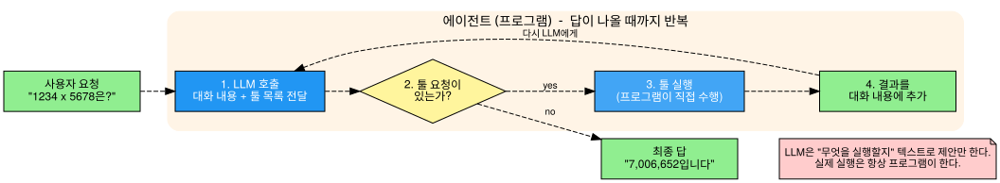

그림의 "1234 x 5678" 질문도 제가 만든 가상의 예시입니다. 툴 요청이 없으면 그 응답이 최종 답이고, 있으면 툴을 실행해 결과를 대화에 붙인 뒤 LLM을 다시 부릅니다.

### 2.4 그럼 루프 말고 뭐가 더 필요할까요?

루프 하나로는 부족합니다. 실제로는 이런 부품이 더 필요합니다.

- LLM 제공 서비스(Anthropic, OpenAI 등)와 통신하는 부분
- 사용자를 만나는 창구(Discord, CLI 등)
- 실행할 툴들
- 이전 대화와 지식을 저장하는 기억
- 위험한 행동을 막는 안전장치

ZeroClaw가 이 부품들을 어떻게 나누고 연결했는지가 이 글의 나머지입니다.

## 3. ZeroClaw 전체 그림 한 장

부품을 어떻게 연결했는지 먼저 한 장으로 보겠습니다. 4~7절은 이 그림을 네 부분으로 나눠 하나씩 확대합니다.

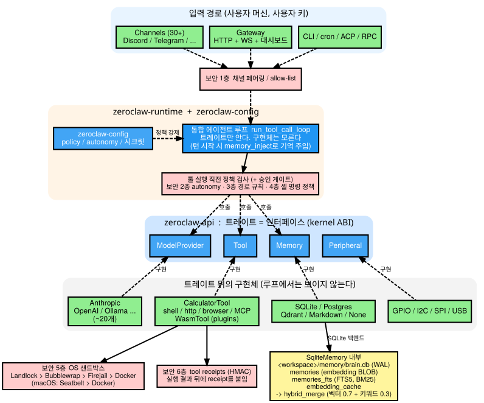

위에서 아래로 읽으면 됩니다.

1. 바깥의 입력 경로(채널, 게이트웨이, CLI)가 메시지를 받습니다. 여기서 **보안 1층**이 먼저 아무나 들어오지 못하게 거릅니다.
2. **에이전트 루프**가 메시지를 처리합니다. 턴을 시작할 때 기억을 꺼내 대화에 넣어 줍니다.
3. 툴을 실행하기 직전에 **보안 2~4층**과 승인 게이트가 검사합니다.
4. 루프는 프로바이더·툴·메모리를 **트레이트(인터페이스)를 통해서만** 부릅니다. 루프와 구현체 사이에는 직접 화살표가 없습니다.
5. 트레이트 뒤에 실제 구현체가 있습니다. 툴이 셸 등을 실행할 때는 **보안 5층**(OS 샌드박스)이 격리하고, 결과에는 **보안 6층**(tool receipt)이 붙습니다.
6. 메모리는 여러 백엔드 뒤에 있고, SQLite 백엔드는 벡터 검색과 키워드 검색을 섞습니다.

| 절 | 확대해서 볼 부분 |
|---|---|
| 4 | 에이전트 루프 |
| 5 | 커널: 트레이트와 구현체 |
| 6 | 메모리 |
| 7 | 6층 보안 구조 |

보안 5, 6층의 위치는 "툴 실행 시 적용된다"는 뜻으로 그린 것이고, 코드상의 정확한 호출 경로를 그린 건 아닙니다.

## 4. 실제 루프: 모든 입력이 하나의 엔진을 지납니다

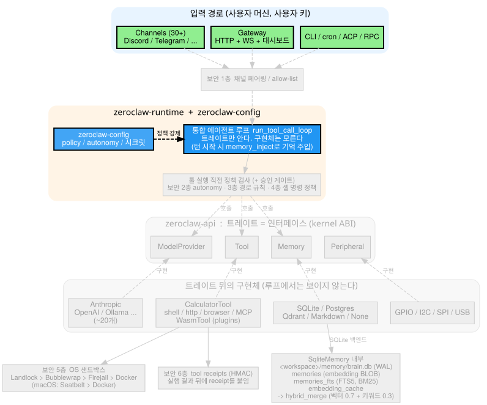

### 4.1 왜 입력 경로마다 루프를 만들지 않았을까요?

채널, CLI, cron, 게이트웨이 WebSocket, RPC, ACP, 임베디드 API. 입력 경로가 이렇게 많은데도 **전부** `run_tool_call_loop`라는 함수 하나를 거칩니다(`crates/zeroclaw-runtime/src/agent/turn/mod.rs`). 진입점은 경로마다 다르며, `loop_.rs`의 처리 함수와 `agent.rs`의 래퍼 등이 공유 엔진을 호출합니다. 공유 엔진을 쓰더라도 경로별 옵션과 승인 전달 방식은 다를 수 있습니다.

입력 경로마다 루프를 따로 만들었다면 승인, 취소, 스트리밍, 보안 로직이 경로마다 갈라졌을 겁니다. 하나로 합치면 **반복 처리의 공통 로직을 CLI와 Discord에서 재사용**할 수 있습니다. 다만 채널별 인증·승인 경로는 각각 검증해야 합니다. 보안 로직도 한 곳만 고치면 됩니다.

### 4.2 루프 한 바퀴는 이렇게 돕니다

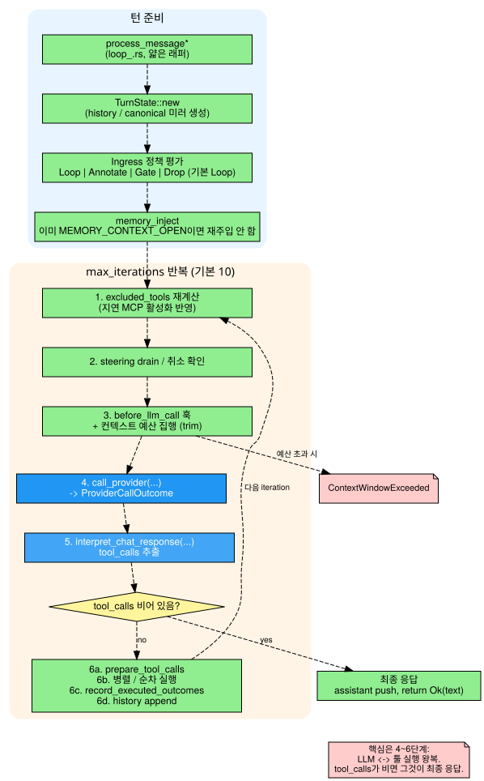

그림 위쪽(파랑)은 **턴 준비**, 아래쪽(주황)은 **반복 구간**입니다. 2.3절의 의사코드와 똑같은 구조입니다.

1. LLM을 호출합니다.
2. 응답에서 `tool_calls`를 뽑습니다.
3. **비어 있으면 그게 최종 응답**이라 끝냅니다.
4. 있으면 툴을 실행해 결과를 history에 붙이고 다음 반복으로 갑니다.

반복 횟수에는 설정에 따른 상한이 있습니다(`max_iterations`). LLM이 툴만 계속 호출하며 끝나지 않는 상황을 막기 위한 상한입니다.

### 4.3 예시로 따라가 보겠습니다

**[예시]** 사용자가 CLI에서 "1234 곱하기 5678은?"이라고 물었다고 해 봅시다.

| 반복 | 일어나는 일 |
|---|---|
| 준비 | 메시지를 받아 history를 만들고, 필요하면 메모리를 대화에 주입 |
| 1회차 | LLM 호출 → 응답에 `calculator(1234*5678)` 요청이 있음 → 승인 확인 후 툴 실행 → 결과를 history에 추가 |
| 2회차 | 결과가 담긴 history로 LLM 재호출 → 툴 요청 없이 "결과는 7,006,652입니다" → **최종 응답**으로 종료 |

툴이 필요 없는 질문이면 1회차에서 바로 끝납니다. 툴을 여러 번 써야 하면 반복이 늘고, 상한에 걸리면 멈춥니다.

여기까지가 에이전트의 본체입니다. 그런데 이 루프 코드에는 프로바이더가 Anthropic인지 OpenAI인지, 툴이 셸인지 브라우저인지가 드러나지 않습니다. 어떻게 그게 가능한지는 다음 절에서 다룹니다. (스트리밍 처리나 컨텍스트 예산 같은 루프의 세부는 부록 A에 있습니다.)

## 5. 루프가 구현체를 모르는 이유: 트레이트로 그은 경계

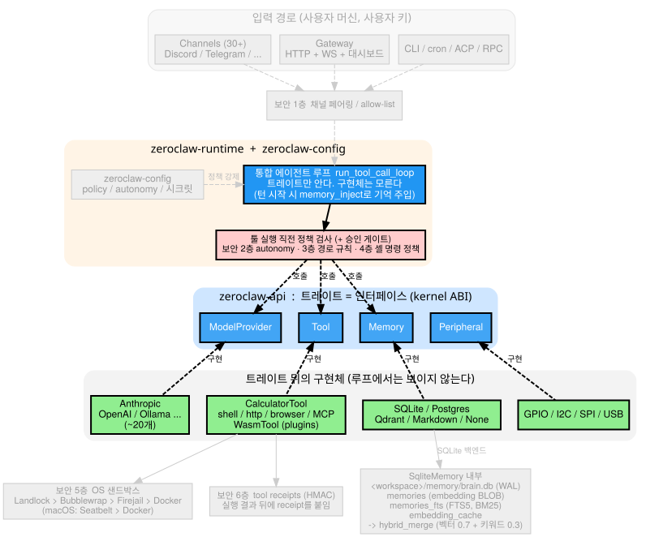

### 5.1 "커널"이라는 이름이 붙은 이유

**마이크로커널**은 최소한의 핵심만 두고 나머지 기능을 교체 가능한 모듈로 바깥에 두는 설계입니다. ZeroClaw에서 "커널"은 `zeroclaw-api` 크레이트(패키지 단위)에 들어 있는 **트레이트 모음**, 즉 인터페이스 모음을 가리킵니다. C++로 치면 순수 가상 클래스만 모아 둔 헤더 하나입니다.

루프는 이 헤더만 include합니다. 뒤에 Discord가 붙었는지 Telegram이 붙었는지는 전혀 모릅니다. 그래서 채널을 새로 붙여도 루프는 한 줄도 바뀌지 않습니다. 기능 추가 비용이 "새 구현체 하나 작성"으로 한정되는 겁니다.

| 구분 | 커널 (트레이트, 루프) | 바깥 (구현체) |
|---|---|---|
| 아는 것 | 메서드 시그니처 | 자기 자신의 구체 구현 |
| 모르는 것 | 어떤 프로바이더/채널/툴이 붙는지 | 루프의 내부 동작 |
| 새 기능 추가 시 | 수정 없음 | 트레이트를 구현하는 코드 추가 |

ZeroClaw 문서는 이 인터페이스 모음을 "kernel ABI"라고 부릅니다. 리눅스 디바이스 드라이버 구조와 대응시키면 이렇습니다.

| | 리눅스 | ZeroClaw |
|---|---|---|
| 커널이 정의하는 규격 | 드라이버 인터페이스 (`file_operations` 등) | `zeroclaw-api`의 트레이트 |
| 규격을 구현하는 쪽 | 디바이스 드라이버 | Provider / Tool / Memory 구현체 |
| 호출하는 쪽 | 커널 코어 (드라이버 종류를 모름) | 에이전트 루프 (구현체를 모름) |
| 새 기능 추가 | 드라이버만 추가 | 구현체만 추가 |

다른 점도 있습니다. 드라이버는 런타임에 로드할 수 있지만, ZeroClaw 구현체는 단일 바이너리에 함께 빌드됩니다.

### 5.2 가장 작은 트레이트, Tool을 봅시다

`crates/zeroclaw-api/src/tool.rs`의 핵심만 남기면 이렇습니다.

```rust
#[async_trait]
pub trait Tool: Send + Sync + Attributable {
    fn name(&self) -> &str;
    fn description(&self) -> &str;
    fn parameters_schema(&self) -> serde_json::Value; // LLM function calling용 JSON Schema
    async fn execute(&self, args: serde_json::Value) -> anyhow::Result<ToolResult>;
    // output_schema 등 나머지는 기본 구현이 있어 생략 가능
}
```

줄별로 읽으면 이렇습니다.

- `name`, `description`: LLM에게 툴을 소개하는 문구입니다.
- `parameters_schema`: 2.2절에서 말한 "인자 형식"입니다. JSON Schema로 돌려주며 **그대로 LLM에 전달**됩니다.
- `execute`: 실제로 일하는 부분입니다. 실패해도 예외를 던지지 않고 `Result`로 돌려줍니다.
- `Attributable`: 로그에서 인스턴스를 `<kind>.<alias>` 형태로 식별하게 하는 규약입니다(귀속, attribution).

C++ 기준으로는 가상 함수 4개짜리 추상 클래스입니다. 툴 작성자가 구현할 것은 이 네 가지입니다.

`Attributable`은 직접 구현하지 않고 `tool_attribution!(CalculatorTool, ToolKind::Plugin);` 매크로 한 줄로 붙입니다. 로그 식별 규약을 툴 작성자가 알아서 지키게 두지 않고 **매크로로 강제**합니다. ZeroClaw는 이 방식을 전반에 씁니다. 사람이 기억해야 하는 규칙을, 어기면 컴파일이 안 되는 규칙으로 바꿉니다.

### 5.3 그런 트레이트가 일곱 개 있습니다

`Tool` 말고도 `ModelProvider`(LLM 통신), `Channel`(사용자 창구), `Memory`(장기 기억), `Peripheral`(하드웨어), `Observer`(관찰/로깅), `RuntimeAdapter`(실행 환경)가 있습니다. 메서드 목록은 부록 B에 표로 정리했습니다.

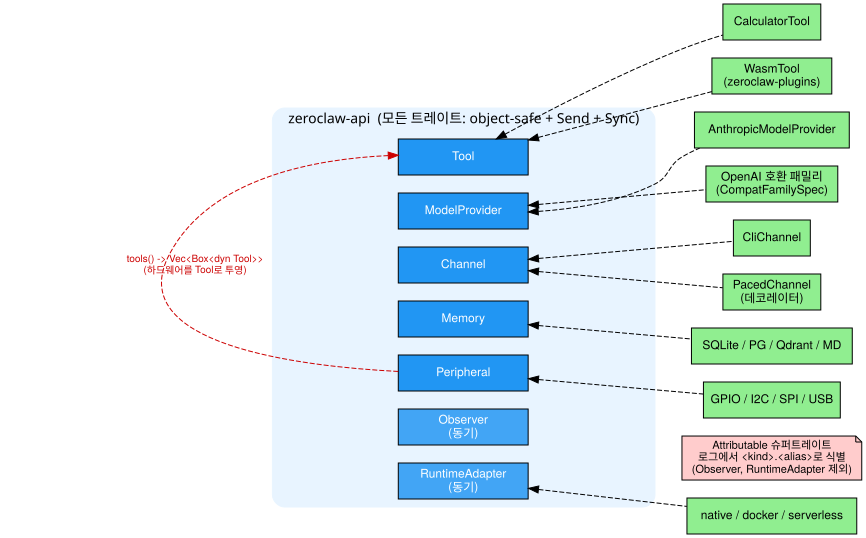

### 5.4 그래서 기능을 붙이려면

| 하고 싶은 일 | 방법 |
|---|---|
| 새 툴 | `Tool` 구현 + `tool_attribution!` |
| 새 채널 | `Channel` 구현 |
| 새 하드웨어 | `Peripheral`을 만들고 `tools()`로 Tool로 투영 |
| 플러그인 | WASM 플러그인용 `WasmTool`이 네이티브와 같은 `Tool`을 구현하므로, 모델은 구별하지 못함 |

트레이트 구현에 더해 레지스트리 등록, 설정과 테스트가 필요합니다. 기존 인터페이스로 표현할 수 있는 확장은 공유 루프의 변경을 줄일 수 있습니다.

같은 원칙이 다음 절의 메모리에도 그대로 적용됩니다.

## 6. 메모리: 갈아 끼울 수 있는 장기 기억

> 여기서 메모리는 OS의 공유 메모리(shm/mmap)가 아니라, 에이전트의 **장기 기억 저장소**를 뜻합니다.

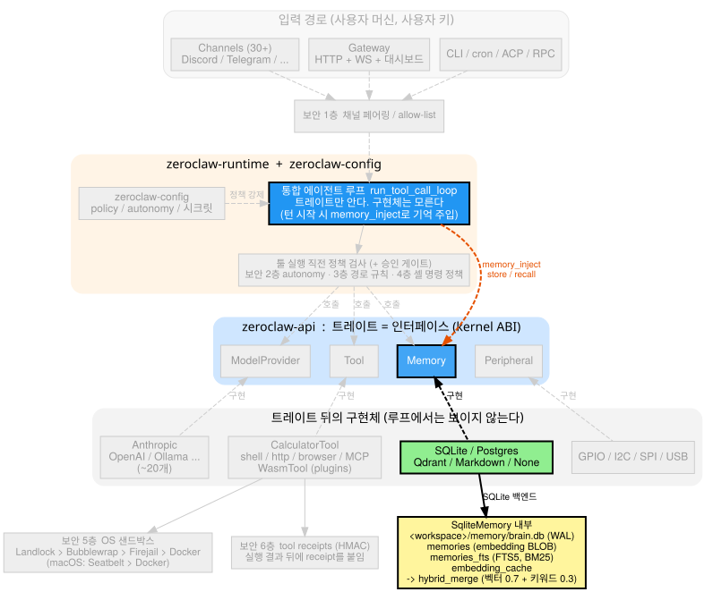

### 6.1 왜 기억 저장소가 따로 필요할까요?

LLM은 대화가 끝나면 아무것도 기억하지 못합니다. 어제 알려 준 선호나 프로젝트 정보를 오늘도 알게 하려면, 프로그램이 그걸 **저장해 뒀다가 필요할 때 꺼내서 프롬프트에 다시 넣어 줘야** 합니다. 그 저장소가 Memory입니다.

구조는 5절과 똑같습니다. 루프는 `Arc<dyn Memory>`(참조 카운트로 공유되는 인터페이스 포인터)만 들고 있고, 그 뒤에 SQLite, Postgres, Qdrant, Markdown 파일, 혹은 None(안 씀) 백엔드가 붙습니다. 루프는 어느 쪽인지 모릅니다.

프롬프트 내용, 툴 결과, 파일은 **memory write가 실제로 일어나야만** 장기 기억이 됩니다. 대화에 나왔다고 자동으로 쌓이지는 않습니다.

### 6.2 기억을 어떻게 찾을까요? 두 방식을 섞습니다

기억을 꺼내려면 검색이 필요한데, 방식이 두 가지입니다.

| 방식 | 원리 | 강점 | 약점 |
|---|---|---|---|
| 키워드 검색 (BM25) | 단어가 겹치는 정도로 점수 | "ZC-4521" 같은 정확한 단어에 강함 | 표현이 다르면 못 찾음 |
| 벡터 검색 (임베딩 + cosine) | 문장을 숫자 벡터로 바꿔 의미가 가까운 것을 찾음 | 표현이 달라도 의미가 같으면 찾음 | 정확한 단어 일치에는 약할 수 있음 |

**[예시]** 저장된 기억이 "사용자는 매주 금요일에 배포한다"라고 합시다. "언제 릴리스하지?"라고 물으면 키워드 검색은 겹치는 단어가 없어서 놓칩니다. 벡터 검색은 "배포"와 "릴리스"가 의미상 가깝다고 보고 찾아냅니다. 반대로 정확한 티켓 번호는 키워드 쪽이 더 잘 찾습니다. 그래서 둘을 **섞습니다**.

### 6.3 SQLite 백엔드는 이렇게 섞습니다

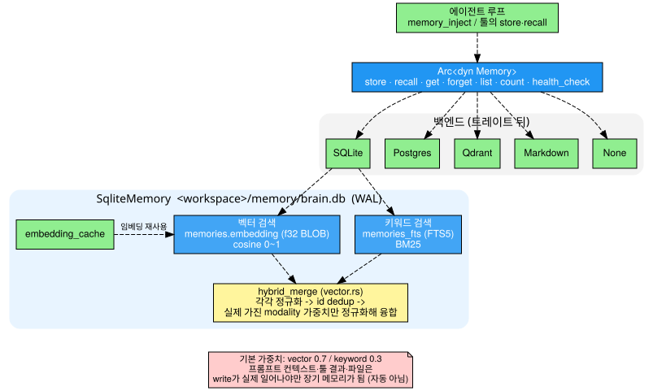

```rust
pub struct SqliteMemory {
    alias: String,
    conn: Arc<Mutex<Connection>>,
    embedder: Arc<RwLock<Arc<dyn EmbeddingProvider>>>,
    vector_weight: f32,   // 기본 0.7
    keyword_weight: f32,  // 기본 0.3
    cache_max: usize,
    search_mode: SearchMode,
}
```

- `conn`: 공유 포인터에 뮤텍스를 씌운 DB 연결입니다.
- `embedder`: 읽기/쓰기 락으로 감쌌다는 건 실행 중에 임베딩 공급자를 교체할 수 있다는 뜻입니다.
- 가중치는 벡터 0.7, 키워드 0.3입니다. 기본은 의미 검색에 더 무게를 둡니다.

저장은 `<workspace>/memory/brain.db` 한 파일에 하고, 테이블은 `memories`(임베딩은 BLOB), `memories_fts`(FTS5 키워드 인덱스), `embedding_cache` 세 개입니다.

점수를 합치는 `hybrid_merge`는 두 가지 방식으로 동작합니다.

1. **벡터 점수는 그대로, 키워드 점수는 최대값으로 나눕니다.** 이 구현의 cosine 점수는 이미 0~1로 제한됩니다. 키워드 점수는 이번 후보 집합의 최대 점수로 나눕니다. 최대값이 거의 0이면 분모로 1을 사용합니다.
2. **후보에게 존재하는 점수만 가중 평균합니다.** 두 점수가 모두 있으면 `(wv × v + wk × k) / (wv + wk)`, 벡터만 있으면 `v`, 키워드만 있으면 `k`입니다. 참여 가중치의 합이 거의 0이면 최종 점수는 0입니다. [고정 커밋의 계산 코드](https://github.com/zeroclaw-labs/zeroclaw/blob/ea4a54bb5bd77dd56fb76e919754bc5d63a099c3/crates/zeroclaw-memory/src/vector.rs#L73)

**[계산 예시]** 가중치가 0.7과 0.3이고 한 후보의 벡터 점수가 0.8, 정규화한 키워드 점수가 0.5이면 최종 점수는 `0.7 × 0.8 + 0.3 × 0.5 = 0.71`입니다. 키워드 점수 0.5만 있는 후보는 `0.3 × 0.5 / 0.3 = 0.5`입니다. 이 값은 코드의 수식을 설명하기 위한 예시이며 검색 품질 벤치마크는 아닙니다.

### 6.4 루프와는 이렇게 만납니다

- 루프는 턴을 시작할 때 `memory_inject`로 관련 기억을 대화에 넣습니다. 이미 넣은 턴에 또 넣지 않도록, 넣을 때마다 똑같은 결과가 되게(idempotent) 만들었습니다.
- 툴은 `store`/`recall`로 직접 기억을 읽고 씁니다.
- `Memory`의 일부 메서드는 기본 구현이 에러(`bail!`)입니다. 구현을 깜빡해도 조용히 넘어가지 않고 실패합니다. 다음 절의 핵심 원칙과 같은 방향입니다.

## 7. 보안: 6겹으로 나눠서 막습니다

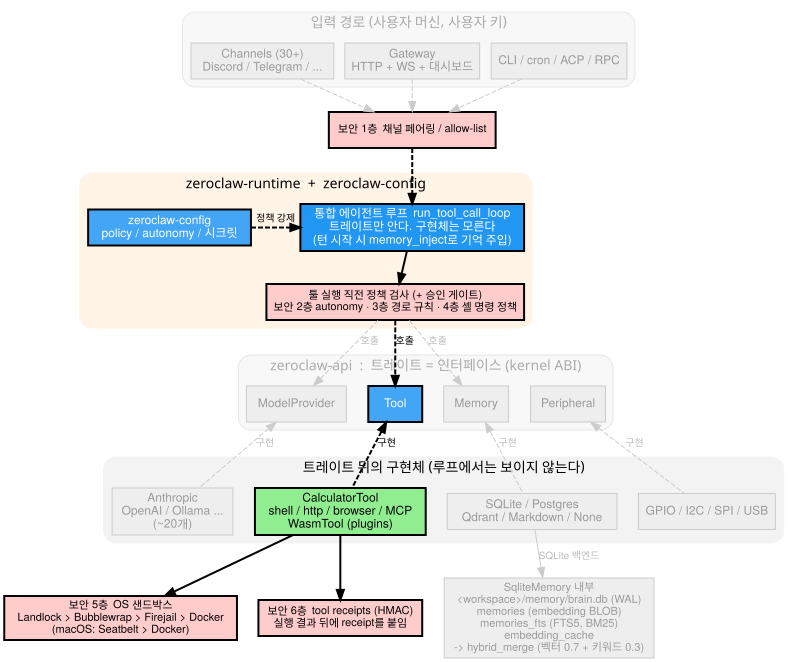

### 7.1 왜 다른 프로그램보다 어려울까요?

일반 프로그램은 개발자가 짠 코드만 실행합니다. 에이전트는 **무엇을 실행할지 LLM이 그때그때 정하고**, 그 툴에 셸과 파일 접근이 들어 있습니다. LLM은 실수하거나, 악의적인 입력(프롬프트 인젝션)에 속을 수 있습니다. 그래서 LLM이 요청한 대로 모두 실행하면 위험합니다.

그래서 ZeroClaw는 세 가지 원칙을 씁니다.

1. **한 겹이 뚫려도 다음 겹이 막습니다.** 단일 게이트는 단일 실패 지점이기 때문입니다.
2. **불확실하면 허용이 아니라 거부합니다.** 이를 fail-closed라고 부릅니다. 반대인 fail-open은 "모르겠으면 통과"입니다.
3. **규칙은 사람의 주의가 아니라 컴파일러와 기본값이 지키게 합니다.** 5.2절의 매크로가 그 예입니다.

보안은 루프·메모리처럼 독립된 모듈이 아니라 처리 흐름 전체에 걸쳐 분산되어 있습니다. 그림의 붉은 박스가 그 위치입니다.

### 7.2 6개 층 한눈에 보기

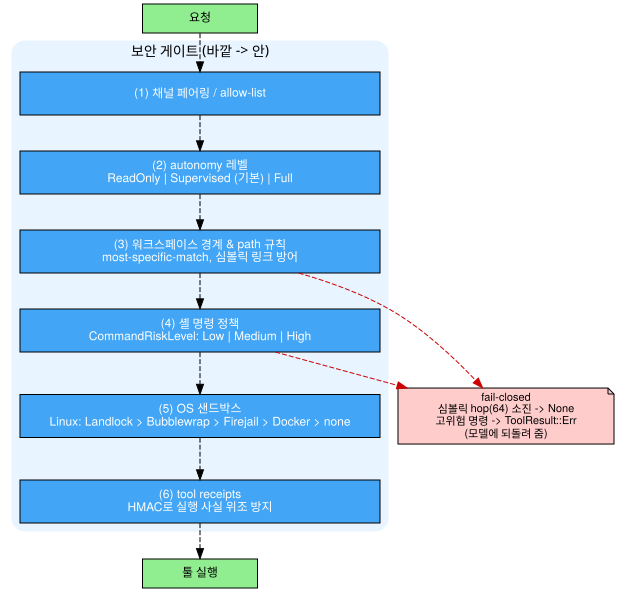

| 층 | 게이트 | 무엇을 막는가 |
|---|---|---|
| 1 | 채널 페어링 / allow-list | 아무나 말을 거는 것 |
| 2 | autonomy 레벨 | 에이전트가 할 수 있는 행동의 상한 |
| 3 | 워크스페이스 경계와 경로 규칙 | 허용 영역 밖의 파일 접근, 심볼릭 링크 탈출 |
| 4 | 툴 정책, 셸 명령 정책, 승인 게이트 | 위험한 명령 실행 |
| 5 | OS 샌드박스 | 위 층이 뚫려도 OS 수준에서 격리 |
| 6 | tool receipts | LLM이 "실행했다"고 거짓 서술하는 것 |

이 표와 그림은 역할을 이해하기 위한 분류입니다. 모든 층이 모든 환경에서 켜지는 것은 아닙니다. 특히 OS 샌드박스는 사용 가능한 백엔드와 설정에 의존하고, receipt는 선택 기능이며 실행을 차단하는 게이트가 아닙니다. 아래에서 1층부터 순서대로 봅니다.

### 7.3 1층: 아무나 말을 걸지 못하게

Discord나 Telegram 봇은 공개된 곳에 있으니, 누구나 메시지를 보낼 수 있습니다. 그 메시지가 곧 셸 실행 요청이 될 수 있으므로 가장 바깥에서 먼저 "허용된 사용자인가"를 확인합니다. 채널 페어링과 allow-list가 이 일을 합니다. (이 층의 세부 동작은 제가 확인한 자료에 없어서, 여기서는 역할만 적습니다.)

### 7.4 2층: autonomy, 행동의 상한

```rust
pub enum AutonomyLevel {
    ReadOnly,       // 관찰만, 행동 불가
    #[default]
    Supervised,     // 위험 작업은 승인 필요 (기본값)
    Full,           // 정책 범위 내 자율 실행
}
```

- `#[default]`가 붙은 `Supervised`가 **기본값**입니다. 설정을 안 하면 안전한 쪽으로 동작합니다.
- 선언 순서(`ReadOnly < Supervised < Full`)가 그대로 비교 연산이 됩니다. 이 비교를 서브에이전트 권한 검사에 씁니다.
- 승인자가 없을 때(`OnNoApprover`)의 기본은 Deny이고, 승인 타임아웃 기본은 120초입니다.

**[예시]** 부모 에이전트가 `Supervised`인데 자식 서브에이전트를 `Full`로 만들려 하면, 순서 비교로 "부모보다 높다"를 바로 알아채고 막을 수 있습니다(`ensure_no_escalation_beyond`).

### 7.5 3층: 파일 경계와 심볼릭 링크

- 경로 규칙은 가장 구체적인 규칙이 이깁니다(most-specific-match). 다만 forbidden의 깊이가 allow의 깊이 이상이면 deny가 이깁니다.
- 심볼릭 링크는 허용 폴더 밖을 가리켜서 경계를 우회하는 데 쓰일 수 있습니다. `resolve_symlinked_path`가 링크를 따라가되 **64 hop 예산**을 두고, 다 쓰면 `None`을 반환해서 fail-closed로 끝냅니다. 끝없는 링크 체인에서도 "모르겠으니 거부"로 수렴합니다.

### 7.6 4층: 툴 정책, 셸 명령, 승인 게이트

**툴 정책.** 특정 툴의 허용/제외를 코드 한 줄이 결정합니다.

```rust
pub fn is_tool_allowed(&self, name: &str) -> bool {
    let allowed = self.allowed_tools.as_ref()
        .is_none_or(|list| list.iter().any(|t| t == name));
    allowed && !self.is_tool_excluded(name)
}
```

`allowed_tools`가 없으면(`is_none_or`) 통과하고, 있으면 목록에 이름이 있어야 통과합니다. 그리고 마지막 `&& !is_tool_excluded`가 붙어서 **제외가 허용을 이깁니다.** 두 규칙이 충돌했을 때 누가 이기는지가 코드 한 줄로 확정되어 있습니다.

**셸 명령.** `command_risk_level_for_shell()`이 `Low/Medium/High`를 매기고, 결과에 따라 이렇게 동작합니다.

| 조건 | 동작 |
|---|---|
| High + `block_high_risk_commands` 켜짐 | 차단 |
| Supervised + 미승인 | 승인 요구 |
| 차단됐을 때 | 실패·거부 결과를 대화 이력에 담아 **모델에게 알려 줌** |
| 서브에이전트 | 권한 상승 차단 (autonomy는 부모 이하, forbidden_paths는 추가만 가능하고 삭제 불가) |

차단 사실을 모델에게 알려 주면 모델이 다른 방법을 시도할 수 있습니다. 조용히 무시하면 모델은 성공한 것으로 착각할 수 있습니다.

**승인 게이트.** 툴 실행 직전에 `gate_tool_approval`이 사람의 승인이 필요한지 판단합니다.

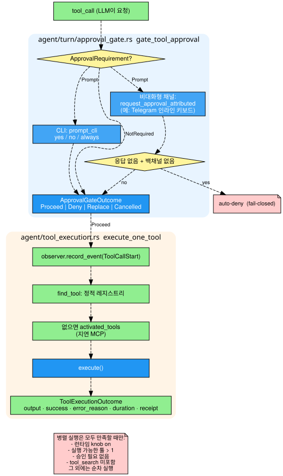

- CLI는 yes/no/always를 터미널에서 묻습니다.
- 비대화형 채널은 인라인 승인(예: Telegram 인라인 키보드)을 시도합니다.
- **응답이 없고 물어볼 길도 없으면 자동 거부**합니다. 물어볼 수 없으면 실행하지 않는 것, 이것이 fail-closed입니다.
- 결과는 `ApprovalGateOutcome { Proceed, Deny, Replace, Cancelled }` 중 하나로 표현됩니다.

승인을 통과하면 `execute_one_tool`이 실행합니다. 정적 레지스트리에서 툴을 찾고, 없으면 지연 로딩되는 MCP 툴(외부 도구를 에이전트에 연결하는 프로토콜)에서 찾습니다.

### 7.7 5층: OS 샌드박스, 마지막 벽

1~4층은 모두 **소프트웨어 검사**라서 코드에 버그가 있으면 뚫릴 수 있습니다. 그래서 마지막에 OS 수준의 격리를 둡니다. 샌드박스는 자동으로 감지됩니다.

| OS | 감지 순서 |
|---|---|
| Linux | Landlock(커널 5.13+) → Bubblewrap → Firejail → Docker → none |
| macOS | Seatbelt → Docker → none |

위에서 하나라도 뚫려도, 지원되는 OS 샌드박스가 실제 활성화된 경우 프로세스가 접근할 수 있는 자원을 OS가 제한합니다. `none`으로 실행하면 이 격리는 제공되지 않습니다.

### 7.8 6층: tool receipt, 실행 사실의 위조 방지

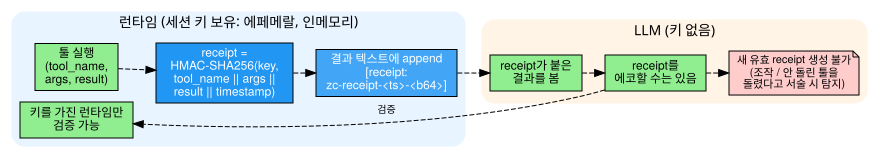

1~5층은 "나쁜 행동을 못 하게" 막습니다. 6층은 다른 문제를 풉니다. LLM은 **돌리지 않은 툴을 돌렸다고 말하거나 결과를 꾸며 낼 수 있습니다.** 그래서 receipt 기능을 켜면 성공한 툴 실행 결과에 HMAC 인증 태그를 붙입니다. 거부·차단·실패·중단된 호출에는 붙지 않습니다.

```
receipt = HMAC-SHA256(key, tool_name || args || result || timestamp)
```

HMAC은 비밀 키를 아는 쪽만 만들 수 있는 "도장"입니다. 내용이 바뀌면 도장도 달라지고, 키가 없으면 유효한 도장을 새로 찍을 수 없습니다. 키는 메모리에만 보관합니다. 채널 서버 경로에서는 채널 런타임 컨텍스트 수명 동안 공유하고, 직접 턴 실행 경로에서는 턴별 scope를 만듭니다.

결과 텍스트 뒤에 `[receipt: zc-receipt-<ts>-<b64>]`가 붙습니다. 모델은 이걸 그대로 복사(에코)할 수는 있어도, 세션 키가 없어서 **새 유효 receipt를 만들 수는 없습니다.** 공식 문서는 호출당 부하를 1ms 미만으로 설명하지만 이 글에서 측정한 값은 아닙니다. 영지식 증명(ZK proof)이 아니므로 키를 가진 런타임이 검증하며, 해당 키의 scope가 사라지면 검증할 수 없습니다. Receipt는 모델의 모든 문장이나 실행의 안전성을 보증하지 않습니다. [적용 조건과 한계](https://github.com/zeroclaw-labs/zeroclaw/blob/ea4a54bb5bd77dd56fb76e919754bc5d63a099c3/docs/book/src/security/tool-receipts.md)

### 7.9 6겹 바깥의 보조 장치 두 가지

**시크릿 암호화.** `crates/zeroclaw-config/src/secrets.rs`에서 ChaCha20-Poly1305로 API 키 등을 암호화합니다. 랜덤 키는 `~/.zeroclaw/.secret_key`(권한 0600, 소유자만 읽기/쓰기)에 두고, config 파일에는 암호문만 남습니다. config가 유출돼도 키 없이는 API 키를 읽을 수 없습니다. 여기서도 **키가 없으면 대체 키를 만들지 않고 거부**합니다(fail-closed).

**위험 프리셋.** 설정 항목을 하나씩 조합하다 위험한 구성을 실수로 만들지 않도록, 이름 붙은 프리셋 중에서 고르게 합니다.

| 프리셋 | 구성 |
|---|---|
| `locked_down_risk` | Supervised + workspace_only |
| `balanced_risk` | Supervised + allowed_commands=["*"] + delegation Allow |
| `yolo_risk` | Full + workspace_only=false + forbidden_paths=[] + auto_approve=["*"] |

`yolo`(You Only Live Once)라는 이름 자체가 "거의 모든 안전장치를 푼다"는 경고 역할을 합니다.

## 8. 정리

1. **에이전트는 루프입니다.** LLM 호출 → 툴 요청 확인 → 실행 → 결과 전달을 답이 나올 때까지 돕니다. 여러 입력 경로가 공유 루프를 사용하지만, 경로별 옵션과 승인 전달은 별도 검증이 필요합니다.
2. **루프는 구현체를 모릅니다.** 트레이트(인터페이스)로 경계를 긋고, 프로바이더·채널·툴·메모리는 그 뒤에서 갈아 끼웁니다. 누락은 컴파일 에러가 됩니다.
3. **기억은 저장소입니다.** 백엔드는 교체 가능하고, SQLite는 키워드와 벡터 검색을 섞어 씁니다.
4. **보안은 여러 경계에서 검사합니다.** 실제 보장은 정책과 활성화된 격리 설정에 따라 달라집니다. LLM이 제안하고 프로그램이 실행한다는 사실(2.2절)이 모든 게이트를 걸 수 있는 자리를 만들어 줍니다.

인터페이스로 경계를 긋고, 입력 경로를 하나로 모으고, 저장소를 교체 가능하게 하고, 안전한 쪽을 기본값으로 두면 됩니다. 언어와 상관없이 가져다 쓸 수 있는 설계입니다.

직접 읽어 볼 파일은 이 순서를 권합니다.

1. `crates/zeroclaw-api/src/tool.rs`: 가장 작은 트레이트
2. `crates/zeroclaw-runtime/src/agent/turn/mod.rs`: 루프
3. `crates/zeroclaw-memory/src/sqlite.rs`: 메모리
4. `crates/zeroclaw-config/src/policy.rs`: 보안 정책

---

## 부록 A. 루프의 세부

본문에서 뺀 루프 구현 디테일입니다. Agent 개념을 이해하는 데는 필요 없지만, 코드를 읽을 때 만나게 됩니다.

**견고하게 만드는 장치**

| 세부 | 효과 |
|---|---|
| 중복 주입 방지 | 이미 `MEMORY_CONTEXT_OPEN`으로 시작하는 history에는 다시 주입하지 않음 |
| 지연 MCP 반영 | 매 반복마다 excluded_tools를 재계산해 도중에 활성화된 MCP 툴을 반영 |
| 컨텍스트 예산 | LLM 호출 전에 trim하고, 초과하면 `ContextWindowExceeded` |
| 병렬 실행 조건 | 런타임 설정 켜짐, 실행할 툴 1개 초과, 승인 불필요, tool_search 미포함의 네 조건을 모두 만족할 때만 병렬, 아니면 순차 |

**상태의 두 수명**

| 상태 | 수명 | 내용 |
|---|---|---|
| `exec: ResolvedAgentExecution` | 에이전트 | 모델 바인딩, 게이트된 툴 레지스트리, approval, observer, receipt 생성기. 한 번 조립해 매 턴 재사용 |
| per-message 턴 상태 | 메시지 | `history`, cancellation_token, on_delta, event_tx, memory, ingress. 메시지마다 새로 생성 |

비싼 조립은 한 번, 메시지마다 가벼운 상태만 새로 만듭니다.

**스트리밍 소비.** LLM 응답은 한 번에 오지 않고 조각으로 옵니다. 조각 종류를 데이터를 가진 enum(`StreamEvent`)으로 표현합니다.

```rust
pub enum StreamEvent {
    TextDelta(StreamChunk),        // 어시스턴트 텍스트 델타
    ThinkingDelta(String),         // 일시적 thinking, 미영속
    ToolCall(ToolCall),            // 스트리밍 중 구조화된 툴콜
    Usage(TokenUsage),             // 보통 Final 직전
    Final,                         // 스트림 완료
}
```

`consume_provider_streaming_response`가 이 스트림을 `while ... .next()`로 소비하면서 `match`로 종류별 처리를 합니다. 하나라도 빠뜨리면 컴파일 에러입니다. `forward_visible!` 매크로가 보이는 텍스트를 두 곳(`event_tx`, `on_delta`)에 동시에 전달하고, 취소는 `tokio::select!`(JS의 `Promise.race`와 비슷)로 경합시키되 부분 텍스트는 보존합니다.

**설정은 스냅샷하지 않는다.** 컨텍스트 한도는 시작 시점 값을 굳히지 않고, 클로저로 매 호출마다 다시 해석합니다. 서버를 재시작하지 않고 설정을 바꿔도 반영되어야 하기 때문입니다.

```rust
Arc<dyn Fn(&str, &str) -> ResolvedContextLimits>  // ContextLimitsResolver
```

## 부록 B. 크레이트, 트레이트, 프로바이더 조립

**크레이트 구성**

| 크레이트 | 역할 |
|---|---|
| `zeroclaw-api` | 공개 트레이트. "커널 ABI" |
| `zeroclaw-runtime` | 에이전트 루프, 보안 정책 강제, SOP 엔진, cron, SubAgents |
| `zeroclaw-config` | TOML 스키마, 시크릿 암호화, autonomy, 워크스페이스 해석 |
| `zeroclaw-providers` | LLM 클라이언트 구현 + 라우팅/재시도/fallback |
| `zeroclaw-channels` | 30+ 메시징 통합 |
| `zeroclaw-gateway` | HTTP/WebSocket 게이트웨이 + 웹 대시보드 |
| `zeroclaw-tools` | 툴 구현 |
| `zeroclaw-memory` | SQLite 메모리, 임베딩, 벡터 검색 |
| `zeroclaw-plugins` | WASM 플러그인 호스트(WIT 컴포넌트 모델) |
| `zeroclaw-hardware` | GPIO/I2C/SPI/USB |
| `zeroclaw-sop-graph` | SOP 그래프 wire shape 단일 소스 |

**트레이트 7개**

| 트레이트 | 한마디로 | 필수 메서드 |
|---|---|---|
| `Tool` | 에이전트가 쓸 수 있는 도구 | name, description, parameters_schema, execute |
| `ModelProvider` | LLM 서비스와의 통신 | `chat_with_system` 하나 (`convert_tools()`가 공통 `ToolSpec`을 프로바이더 네이티브 JSON으로 변환) |
| `Channel` | 사용자와 만나는 창구 | name, send, listen (`listen`은 장수명 inbound 루프) |
| `Memory` | 장기 기억 | store/recall/get/forget/list/count/health_check (private 메서드 기본값은 `bail!`) |
| `Peripheral` | 하드웨어 | connect/disconnect/health_check + `tools()` (하드웨어를 Tool로 투영) |
| `Observer` | 관찰/로깅 (동기) | record_event/record_metric/flush |
| `RuntimeAdapter` | 실행 환경 추상화 (동기) | `build_shell_command()`, `shell_dialect()` (native/docker/serverless) |

모든 트레이트는 `Send + Sync`이고, Observer와 RuntimeAdapter를 제외하면 `Attributable`을 요구합니다.

**프로바이더 조립.** `factory.rs`에서 합니다. OpenAI 호환 계열은 `CompatFamilySpec`에 이름·기본 URL·인증 방식만 **선언**하면 팩토리가 자동 생성됩니다. 디스패치 코드는 `for_each_model_provider_slot!` 매크로가 생성하는데, **구현이 빠진 프로바이더가 있으면 컴파일이 실패**합니다. 문서나 코드 리뷰가 아니라 컴파일러가 완전성을 보증하는 방식입니다. 툴은 `Vec<Arc<dyn Tool>>`에 직접 담고, 채널은 각자 struct로 구현합니다.

## 부록 C. 이 글의 한계

| 영역 | 상태 | 더 읽을 곳 |
|---|---|---|
| `hybrid_merge`의 점수 융합 | 고정 커밋 코드와 대조, 6.3절에 수식·계산 예시 추가 | `crates/zeroclaw-memory/src/vector.rs` |
| 1층(채널 페어링)의 동작 | 역할만 확인 | `crates/zeroclaw-channels` |
| SOP 엔진의 실행 모드별 동작 | 다루지 않음 | `crates/zeroclaw-runtime/src/sop/engine.rs` |
| 플러그인의 2층 네트워크 방어 | 다루지 않음 | `crates/zeroclaw-plugins`의 component.rs 등 |

초안은 ZeroClaw 조사 노트를 바탕으로 작성했습니다. 이후 상단에 밝힌 파일과 receipt 문서를 대조해 수정했지만, 나머지 모든 코드 인용과 운영체제별 동작을 재검증한 것은 아닙니다. 병렬 실행이 네 조건을 요구하는 이유는 "승인이 필요한 툴을 병렬로 돌리면 사용자에게 여러 번 묻게 되기 때문"으로 짐작하지만, 확인된 내용은 아닙니다. 2.3절의 의사코드, 그림의 "1234 x 5678" 질문, 4.3·6.2·7.4절의 **[예시]** 는 이해를 돕기 위해 제가 만든 것입니다.

## 부록 D. 용어집

| 용어 | 뜻 |
|---|---|
| LLM | 텍스트를 입력받아 텍스트를 생성하는 대규모 언어 모델 |
| 에이전트 | LLM 호출과 툴 실행을 반복해 목표를 달성하는 프로그램 |
| 툴 호출(function calling) | LLM이 "이 툴을 이 인자로 실행해 달라"고 구조화된 요청을 하는 방식 |
| 프로바이더 | LLM을 제공하는 서비스(Anthropic, OpenAI 등) |
| 채널 | 사용자와 만나는 창구(Discord, Telegram, CLI 등) |
| 트레이트 | 구현이 지켜야 할 메서드 목록을 정한 인터페이스 |
| 크레이트 | 패키지/빌드 단위 |
| 임베딩 | 문장을 의미가 가까울수록 가깝게 놓이는 숫자 벡터로 바꾼 것 |
| BM25 | 단어가 겹치는 정도로 점수를 매기는 키워드 검색 알고리즘 |
| 하이브리드 검색 | 키워드 검색과 벡터 검색 결과를 섞는 방식 |
| fail-closed | 불확실하면 허용이 아니라 거부하는 원칙 |
| attribution(귀속) | 로그에서 모든 인스턴스를 `<kind>.<alias>`로 식별하게 하는 장치 |
| idempotent | 여러 번 실행해도 결과가 같은 성질 |
| HMAC | 비밀 키로 만드는 위조 방지용 서명 |
| 샌드박스 | 프로세스가 접근할 수 있는 자원을 OS 수준에서 제한하는 격리 환경 |
| MCP | 외부 도구를 에이전트에 연결하는 프로토콜 |
